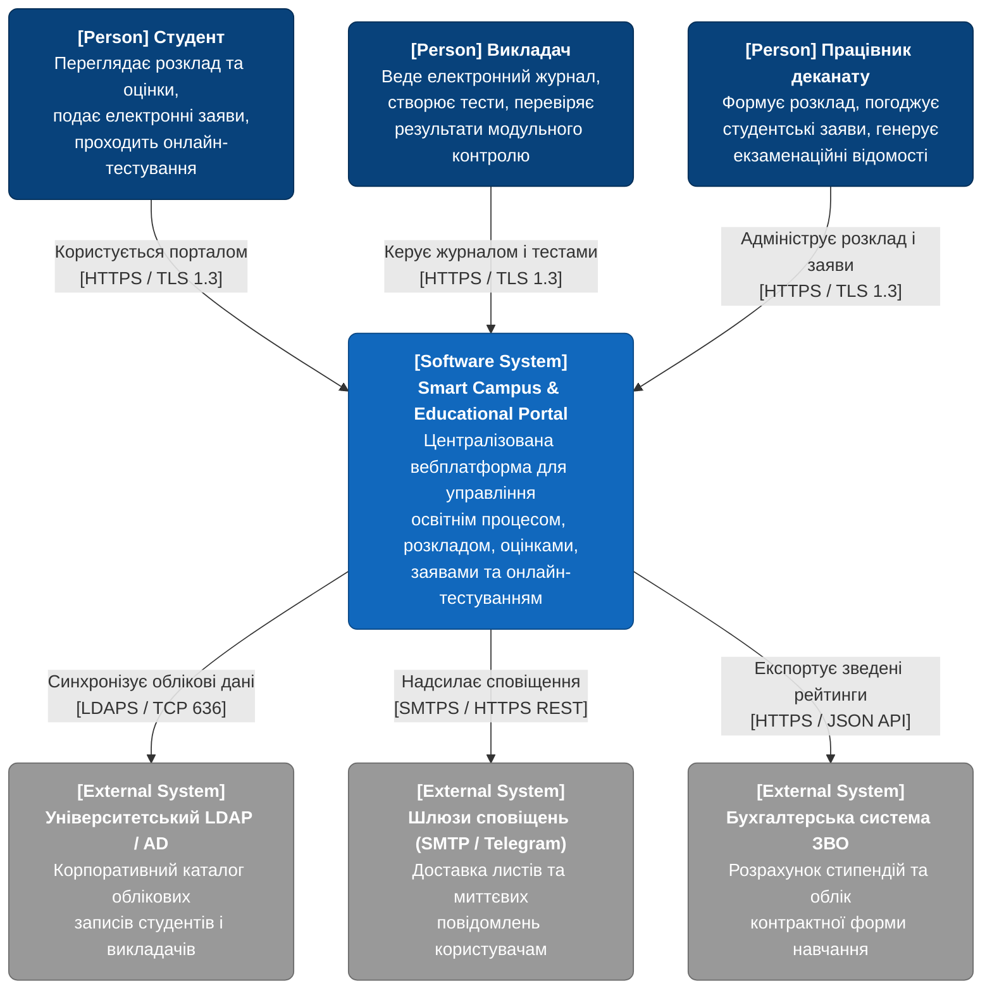
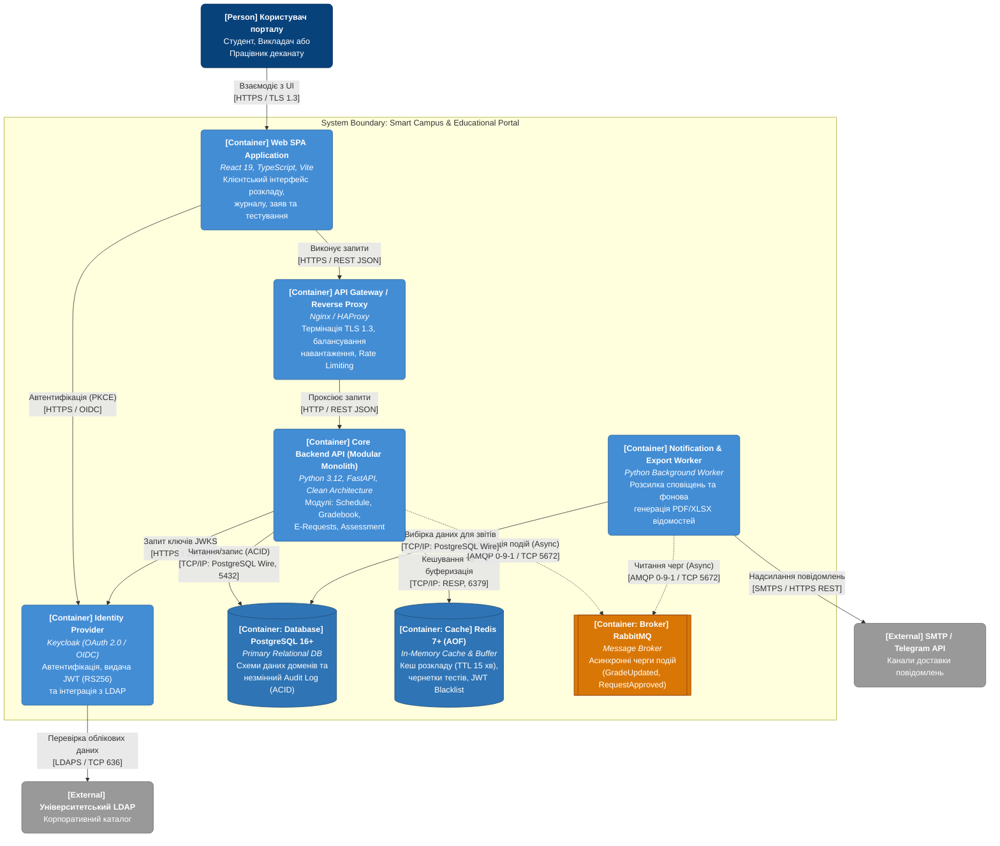
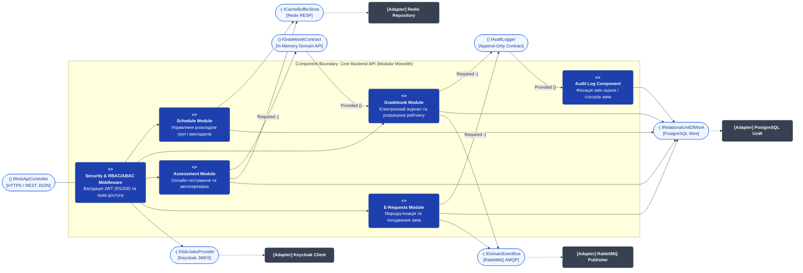
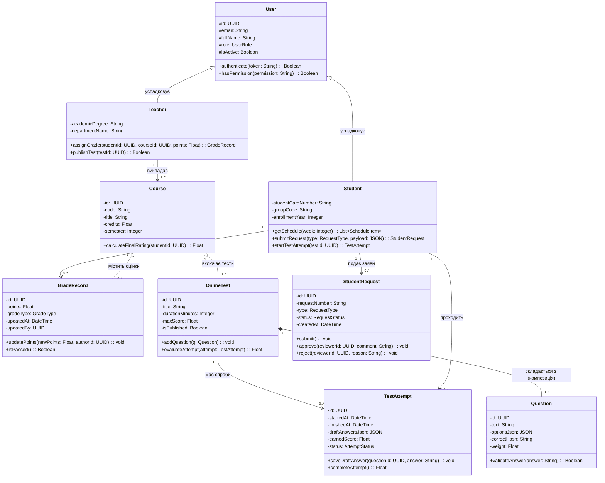
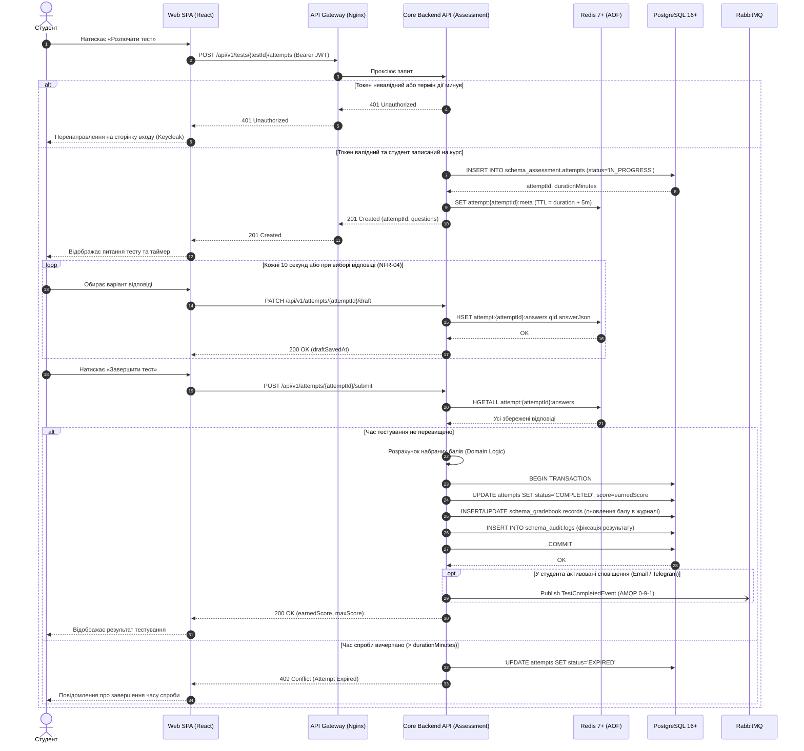
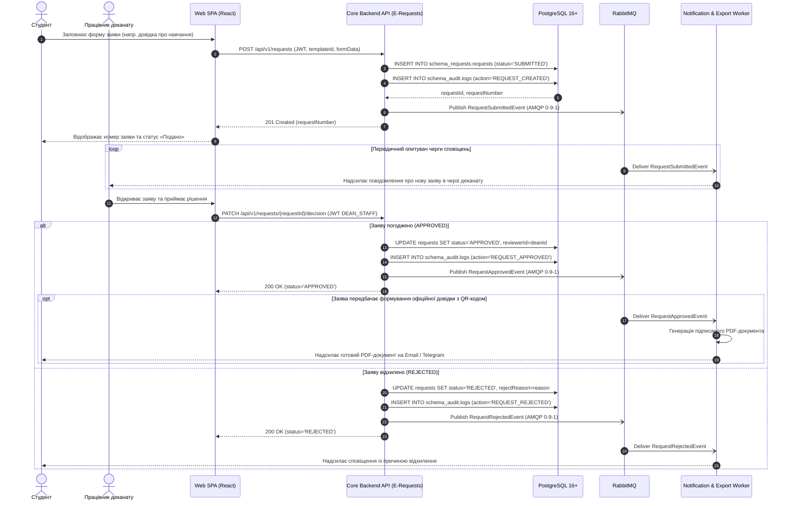
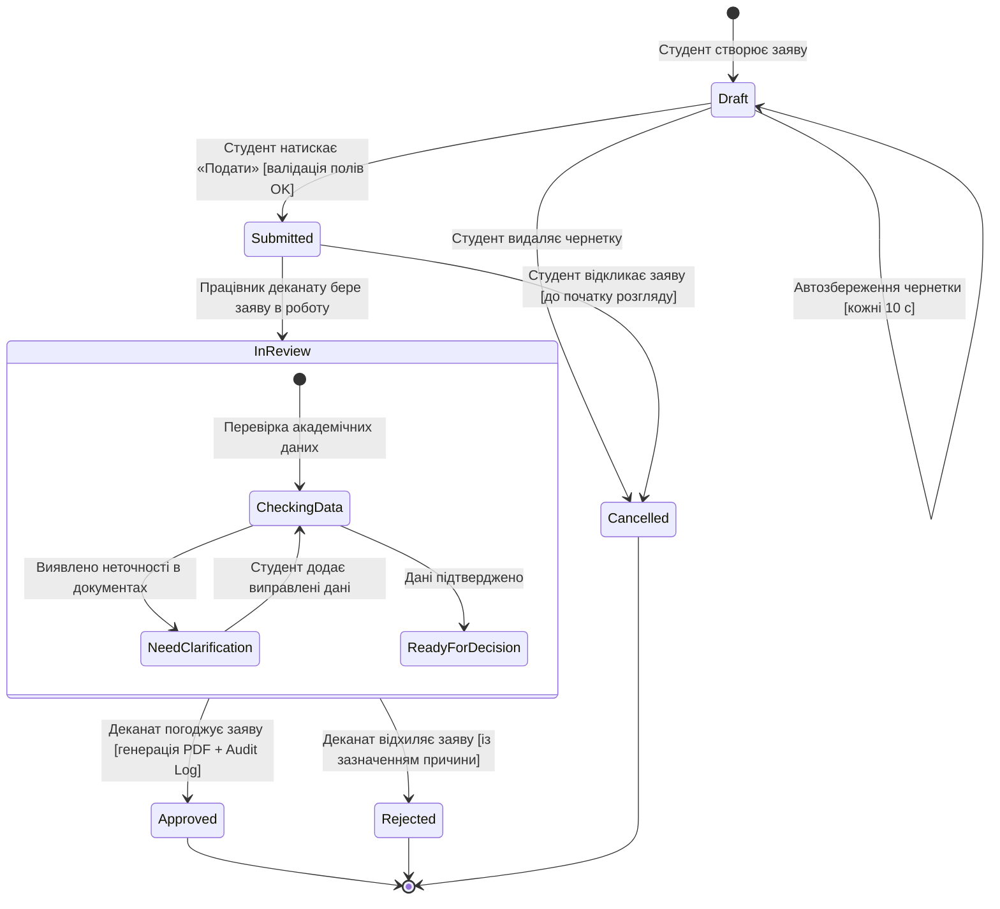

# Архітектурне моделювання системи (C4 Model & UML 2.5) — MILESTONE 2

**Проєкт:** Smart Campus & Educational Portal (Варіант № 3)  
**Виконавець:** Кошик Михайло Сергійович, студент гр. 2ПРс  
**Дисципліна:** Інженерія програмного забезпечення  
**Реліз / Git-тег:** `lr2`  

---

## Огляд архітектурних моделей
У межах Лабораторної роботи № 2 (Milestone 2) із використанням підходу **Diagrams as Code (Mermaid.js)** розроблено комплекс візуальних моделей системи **Smart Campus & Educational Portal**, які деталізують архітектурні рішення, зафіксовані у `ADR-0001`, `ADR-0002` та `ADR-0003`:
* [1. C4 Model: System Context & Container Diagrams](diagrams/01_c4_context_and_container.md)
* [2. Статична структура: UML Component & Domain Class Diagrams](diagrams/02_uml_component_and_class.md)
* [3. Динамічна поведінка: UML Sequence & State Machine Diagrams](diagrams/03_uml_sequence_and_state.md)

---

## 1. Архітектурна модель C4 (Level 1: System Context та Level 2: Container)

### 1.1. C4 Level 1: System Context Diagram
Діаграма демонструє межі системи (`System of Interest`), ролі кінцевих користувачів (Студент, Викладач, Працівник деканату) та інтеграцію із зовнішніми системами університету (LDAP/AD, SMTP/Telegram-шлюзи, бухгалтерська система ЗВО).

### 1.2. C4 Level 2: Container Diagram
Відображає розподіл контейнерів системи та точні мережеві протоколи взаємодії: синхронні (`HTTPS / REST JSON`, `HTTPS / OIDC`, `TCP/IP: PostgreSQL Wire`, `TCP/IP: RESP`) та асинхронні (`AMQP 0-9-1` через брокер повідомлень RabbitMQ).

---

## 2. Статична структура ПЗ (UML Component & Domain Class Diagrams)

### 2.1. UML Component Diagram (C4 Level 3)
Компонентна структура модульного моноліту з відображенням наданих (**Provided** `()`) та запитуваних (**Required** `-(`) інтерфейсів.

### 2.2. UML Domain Class Diagram
Доменна модель із 9 класів зі специфікаторами доступу (`+`, `-`, `#`), типами даних, методами та кратністю зв'язків (`1`, `0..*`, `1..*`).

---

## 3. Динамічна поведінка системи (UML Sequence & State Machine Diagrams)

### 3.1. UML Sequence Diagram — Сценарій 1: Проходження модульного онлайн-тестування

### 3.2. UML Sequence Diagram — Сценарій 2: Подання та розгляд електронної студентської заяви

### 3.3. UML State Machine Diagram — Життєвий цикл сутності `StudentRequest`

