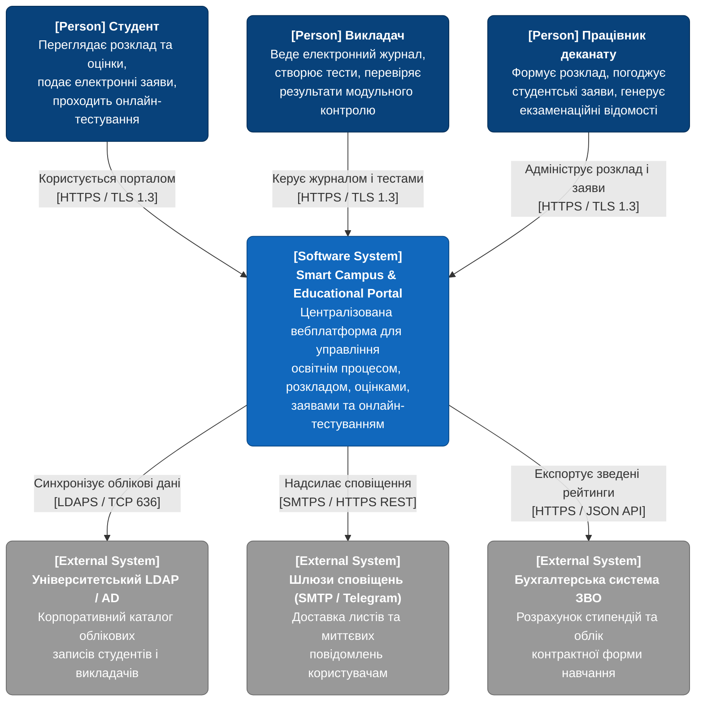
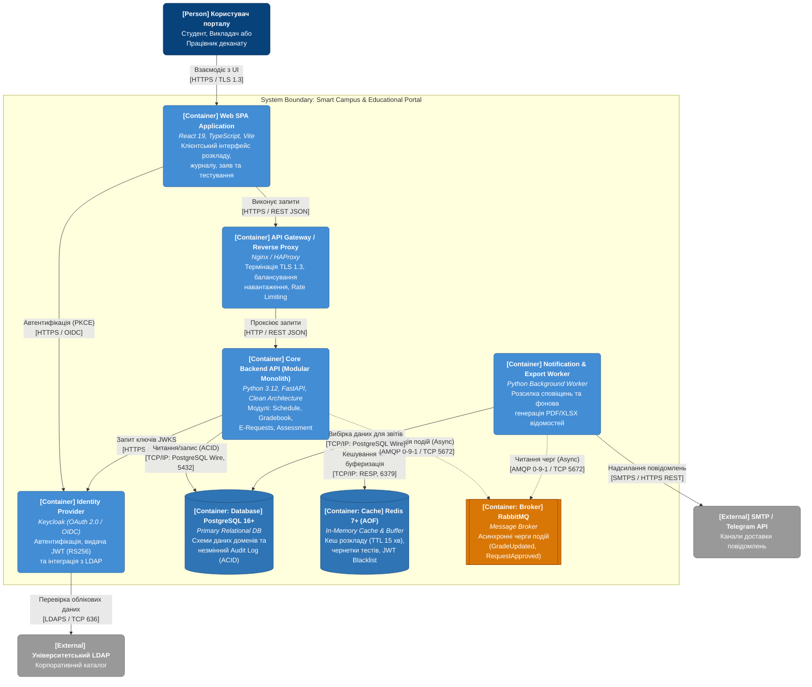

# 1. Архітектурна модель C4 (Level 1: System Context та Level 2: Container)

## 1.1. C4 Level 1: System Context Diagram (Діаграма системного контексту)

Діаграма демонструє межі системи **Smart Campus & Educational Portal** (`System of Interest`), ролі кінцевих користувачів та інтеграцію із зовнішніми інформаційними системами університету.

---

## 1.2. C4 Level 2: Container Diagram (Діаграма контейнерів)

Діаграма деталізує внутрішній технологічний стек відповідно до прийнятих архітектурних рішень (`ADR-0001`, `ADR-0002`, `ADR-0003`) із точним зазначенням мережевих протоколів взаємодії (синхронних та асинхронних):
* **Синхронні виклики:** `HTTPS / REST JSON` (клієнт ↔ API Gateway ↔ Modular Monolith), `HTTPS / OIDC (JWT RS256)` (автентифікація через Keycloak), `TCP/IP (PostgreSQL Wire Protocol)` (робота з БД), `TCP/IP (RESP)` (робота з кешем Redis).
* **Асинхронні виклики:** `AMQP 0-9-1` через брокер повідомлень RabbitMQ для відкладеного розсилання сповіщень та фонової генерації PDF-відомостей.

