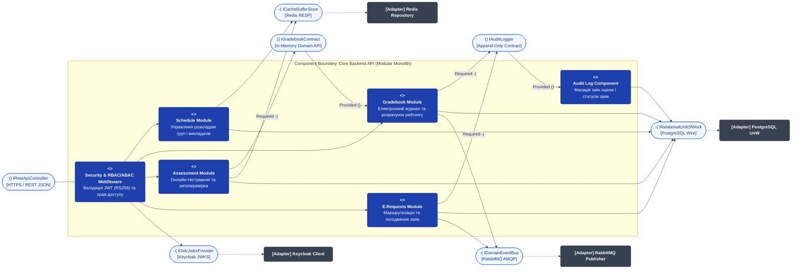
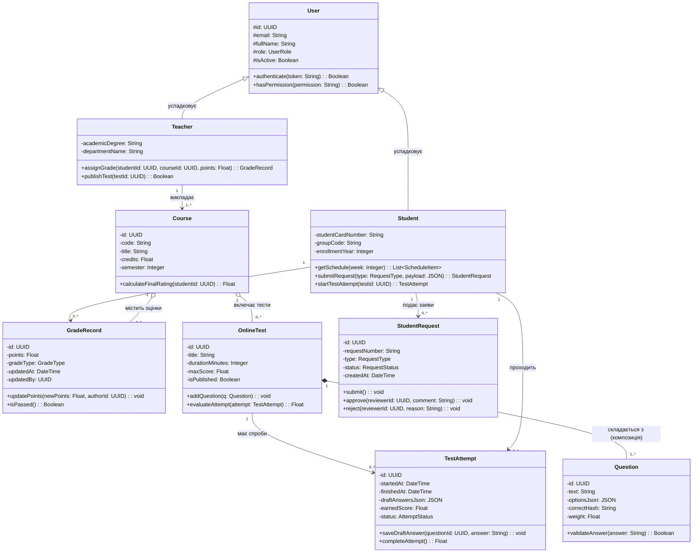

# 2. Статична структура ПЗ (UML Component Diagram та UML Domain Class Diagram)

## 2.1. UML Component Diagram (C4 Level 3: Компонентна архітектура Core Backend API)

Діаграма розкриває внутрішній устрій ключового сервісу **Core Backend API (Modular Monolith)** із відображенням доменних модулів (`Schedule`, `Gradebook`, `E-Requests`, `Assessment`), підсистеми аудиту (`Audit Log`) та інфраструктурних адаптерів.
* **Provided Interfaces (Надані інтерфейси `()`)** — публічні REST-контролери та внутрішні контракти модулів (`IScheduleQuery`, `IGradebookCommand`, `IAssessmentService`, `IRequestWorkflow`).
* **Required Interfaces (Запитувані інтерфейси `-(`)** — зовнішні залежності, необхідні компонентам для роботи (`IRedisCache`, `IPostgresRepository`, `IEventPublisher`, `IOidcTokenValidator`).

---

## 2.2. UML Domain Class Diagram (Діаграма класів доменної моделі)

Діаграма класів описує 8 ключових сутностей домену **Smart Campus & Educational Portal** із дотриманням усіх вимог UML 2.5:
* **Специфікатори доступу:** `+` (`public`), `-` (`private`), `#` (`protected`).
* **Типи даних** атрибутів та параметрів/результатів методів.
* **Кратність зв'язків (`1`, `0..*`, `1..*`) та семантика відношень:**
  * Успадкування (`<|--`): `Student` та `Teacher` успадковують базовий клас `User`.
  * Композиція (`*--`): `OnlineTest` містить `Question` (питання не існують без тесту); `StudentRequest` містить `RequestHistoryEntry` (історія погодження є невід'ємною частиною заяви).
  * Агрегація (`o--`): `Course` об'єднує записи журналу `GradeRecord` та тести `OnlineTest`.

