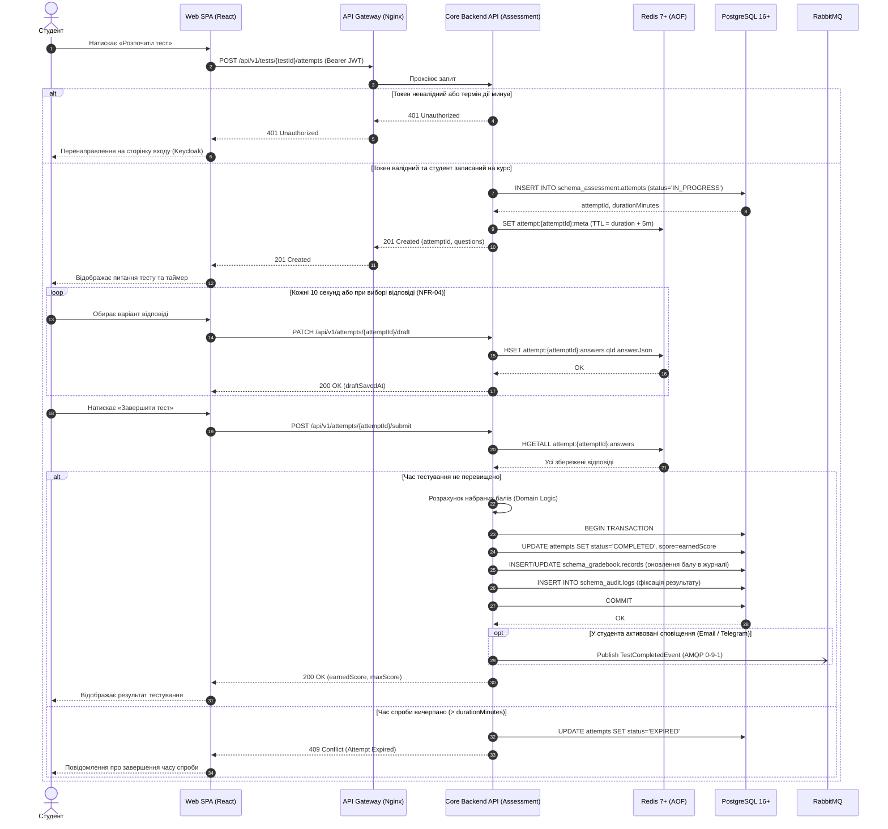
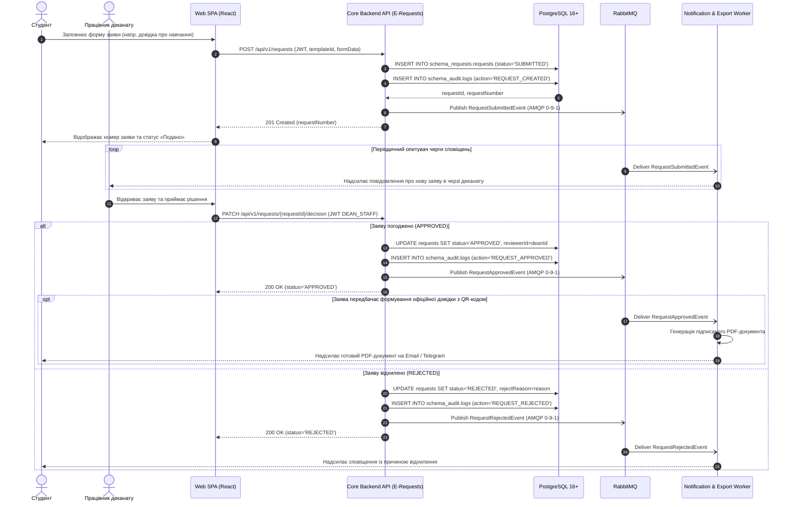
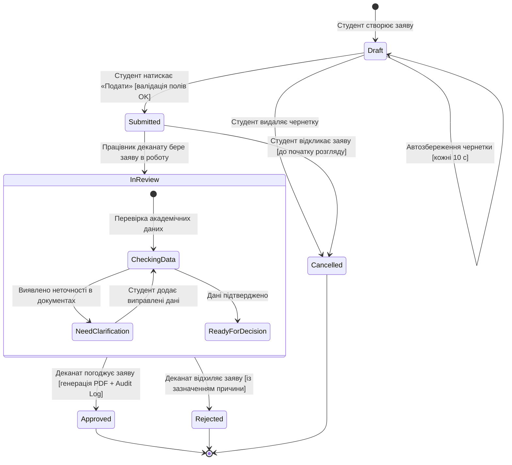

# 3. Динамічна поведінка системи (UML Sequence Diagrams та UML State Machine Diagram)

## 3.1. UML Sequence Diagram — Сценарій 1: Проходження модульного онлайн-тестування

Діаграма моделює процес проходження онлайн-тесту студентом із використанням комбінованих фрагментів UML 2.5:
* **`alt` (Alternative):** перевірка валідності JWT-токена та прав доступу (гілка успіху vs `401 Unauthorized` / `403 Forbidden`), а також перевірка ліміту часу спроби.
* **`loop` (Loop):** періодичне автозбереження чернеток відповідей студента в `Redis 7+` кожні 10 секунд (`NFR-04`, `QAS-1`).
* **`opt` (Optional):** асинхронна публікація події `TestCompletedEvent` у `RabbitMQ` для надсилання сповіщення студенту, якщо у його профілі ввімкнено сповіщення.

---

## 3.2. UML Sequence Diagram — Сценарій 2: Подання та розгляд електронної студентської заяви

Діаграма відображає взаємодію студента та працівника деканату під час подання та погодження електронної заяви з використанням фрагментів **`alt`**, **`opt`** та **`loop`**.

---

## 3.3. UML State Machine Diagram — Життєвий цикл сутності `StudentRequest` (Електронна заява)

Діаграма станів описує повний життєвий цикл електронної заяви студента в системі **Smart Campus & Educational Portal**: від створення чернетки (`Draft`) до фінальних термінальних станів (`Approved`, `Rejected`, `Cancelled`).

